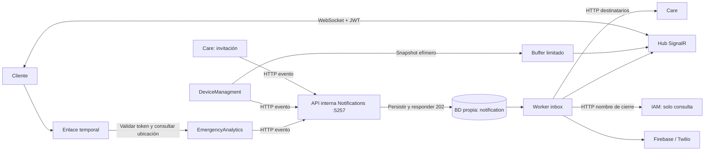

# Foll — NotificationCommunication v2

## Alcance
Extracción .NET 10 del BC v2 desde `../foll-backend`. Propietario de notificaciones, tokens push, SMS, enlaces temporales, recepción durable de eventos y hub SignalR. Se conservan rutas/contratos de los servicios EmergencyAnalytics y DeviceManagment. No se desplegarán servicios ni se ejecutarán migraciones sobre bases existentes durante esta implementación.

**Exclusiones expresas:** no implementar IAM → Notifications por cuenta eliminada; no añadir Care → Devices por paciente eliminado. No habrá receptores/emisores remotos para esas operaciones. En modo remoto se omite la limpieza local de notificaciones de la cuenta, evitando modificar tablas antiguas como si fueran la fuente de verdad.

## Decisiones arquitectónicas
### ADR-001 — Límite del servicio
Se conservan dominio y API v2; adaptadores Firebase/Twilio se extraen desde ExternalServices como infraestructura de este ejecutable. No se referencian proyectos de otros BC: los mensajes son contratos de integración locales, no entidades compartidas.

### ADR-002 — Confirmar recepción durable, no entrega al usuario
Los endpoints de eventos confirman después de persistir una inbox deduplicada. Un worker procesa después Care/IAM/proveedores. Estado de recepción/procesamiento y estado push/SMS son conceptos distintos. Telemetría permanece efímera y no se almacena en la inbox.

### ADR-003 — Consultas de contexto por HTTP
Destinatarios desde Care; datos del usuario que cierra desde IAM; ubicación actual desde EmergencyAnalytics. Clave interna para llamadas de workers, JWT para API de usuarios. Enlace público valida token antes de consultar ubicación.

### ADR-004 — SignalR es una frontera de despliegue distinta
Se conserva `/hubs/notifications`, pero el cliente se conecta a la URL del nuevo servicio o a un reverse proxy WebSocket real. No se reutiliza un proxy HTTP de cuerpos para transportar WebSockets. Se configurará CORS por orígenes explícitos y JWT del hub.

## Bitácora
### 2026-11-13 — Paso 1: inventario y alcance
- Revisados cuatro modelos persistentes originales, comandos/consultas, seis handlers de alertas, ubicación pública, hub y cuatro publicadores realtime.
- Dependencias locales: Care para destinatarios, IAM para nombre de quien cierra, Emergency para datos del incidente; los puertos de invitaciones/telemetría también importan contratos de otros BC y serán sustituidos por contratos locales.
- Se conservarán los cambios anteriores de Emergency/Devices. Care v1 no se modificará automáticamente; se documentará el contrato adicional de destinatarios necesario para integrarlo.
- La inbox anterior del monolito contiene recibos de eventos ya procesados. Deberán trasladarse como mensajes completados, además de los datos del esquema notification, para evitar reenvíos al cambiar de proceso.

## Validación
### 2026-11-13 — Paso 2: servicio y recepción durable (implementado)
- Extraídos NotificationCommunication y adaptadores ExternalServices; contratos de integración locales para emergencias/dispositivos/invitaciones. Sin referencias de proyecto o namespaces de otros BC.
- Contexto propio: cuatro tablas v2 del esquema notification y una inbox nueva con identidad del evento, secuencia, stream, estado, intentos, error y próximo intento.
- Recepción HTTP valida identidad/tipo/payload, usa lock transaccional e ID único y devuelve 202 tras persistir. Duplicados devuelven 200; mismo ID con contenido distinto, 409. Los recibos anteriores pueden importarse como `legacy.completed`.
- Worker procesa un primer evento pendiente por stream/paciente y permite avanzar otros streams si uno falla. Usa contexto/transacción por evento; reintentos con espera creciente. No se promete orden por tiempo de origen si llegan eventos fuera de orden a la API.
- Se conservaron los estados de entrega de v2: resultados fallidos de Firebase/Twilio se registran como Failed, no se reenvía ciegamente todo el evento. La inbox distingue `ProcessedWithDeliveryFailures` de `Processed`; los fallos de contexto/infraestructura que escapan del handler quedan en RetryPending. Esto no es una garantía de entrega final al usuario ni una cola de reenvío individual por destinatario.
- Telemetría con buffer limitado, último dato por dispositivo y caducidad de 30s. Destinatarios/SignalR se resuelven fuera del request de recepción.
- Gateways de destinatarios Care, nombre de cierre IAM y ubicación Emergency; todos admiten autenticación de servicio sin usuario en los workers.
- Retirado de la copia el comando/handler de cuenta eliminada. No existe receptor de ese evento.

### 2026-11-13 — Paso 3: transición y compatibilidad (implementado)
- Monolito mantiene modo local por defecto; flag `NotificationCommunication:RemoteEnabled` habilita proxy público, forward de receptores internos y adaptadores para eventos de BC todavía locales.
- En modo remoto se retiran solo los consumidores MediatR de NotificationCommunication, incluyendo el de cuenta eliminada; no se envía limpieza remota. Se conservan los handlers de MQTT/log del BC Emergency.
- Alertas Devices locales salen de la outbox con el mismo ID estable que el servicio Devices. Emergencias locales se adaptan a los mismos sobres que el servicio Emergency. El modo directo permite configurar ambos servicios para apuntar a :5257 sin pasar por el monolito.
- Invitaciones de Care v2 se encolan en su outbox compartida mediante un adaptador y se entregan al endpoint nuevo. Sigue existiendo una ventana entre guardar el cambio de Care y publicar el evento (el flujo original llama al publicador después del SaveChanges); cerrar esa ventana exige reorganizar esa transacción de Care, fuera de esta extracción.
- Telemetría desde Devices todavía local usa relay acotado, sin esperar HTTP en la ingestión.
- El hub antiguo se deja de mapear en modo remoto. El frontend debe cambiar la URL del hub o usar un proxy WebSocket; no se simula soporte WebSocket con el proxy HTTP.

## Validación
### 2026-11-13 — Paso 4: persistencia, transferencia y pruebas
- Generados `InitialNotificationCommunication`, snapshot y `scripts/schema.sql` con EF, sin aplicar a ninguna base. Historial independiente en `notification.__EFMigrationsHistory`.
- Preparados exportación/importación y manifiesto SHA-256: cuatro tablas v2 y recibos de mensajes completados. Se conserva el hash/caducidad de enlaces y el ID de notificaciones/tokens/SMS; no se copian entidades Care/IAM/Emergency.
- Primer conjunto local: 21 pruebas correctas de identidad de eventos, estados, buffer, permisos HTTP, gateways, push/SMS y fallback. Se añadió después cobertura del proxy de transición.
- Arranque real aislado: correcto, incluyendo conexión WebSocket y handshake SignalR con JWT sintético, sin workers ni migraciones. No se comprobó solamente la ruta HTTP del hub.
- Los errores de red de NuGet dentro del sandbox se resolvieron con restauración autorizada fuera del sandbox. La advertencia CS0618 del adaptador Firebase ya existía en el código original; no se presenta como un error de compilación.

### 2026-11-13 — Paso 5: cierre de validación local
- **26 pruebas Notifications correctas**, 26 pruebas de regresión EmergencyAnalytics correctas y 29 de Devices correctas: **81 en total, 0 fallidas**.
- Arranque real y handshake WebSocket SignalR correctos con JWT sintético; API y hub rechazan solicitudes sin autenticación. Workers/migraciones se desactivaron explícitamente en esa comprobación.
- EF confirmó ausencia de cambios pendientes tanto en el nuevo modelo como en el del monolito. No se agregó otra migración al monolito para esta extracción.
- `git diff --check` pasó; el script PowerShell de transferencia pasó revisión sintáctica. La búsqueda de namespaces de otros BC y comandos excluidos no encontró dependencias en el ejecutable extraído. Care v1 quedó sin cambios.
- Docker Desktop no tiene su motor Linux activo en este entorno. No se validaron PostgreSQL/MQTT reales, importación SQL, envío Firebase/Twilio ni frontend desplegado. El test WebSocket sí utilizó el proceso real del servicio nuevo, pero no proveedores ni datos de producción.
- No se aplicaron migraciones, transfirieron datos, eliminaron cuentas ni activó tráfico real. Los flags permanecen desactivados por defecto.

Para repetir: `dotnet test tests/Foll.NotificationCommunication.Tests.csproj`, `./scripts/Smoke-Test.ps1`, `dotnet tool restore` y `dotnet ef migrations has-pending-model-changes`. Los proyectos de pruebas de Emergency/Devices se ejecutan desde sus carpetas respectivas. La generación de migraciones de esta entrega reutilizó la herramienta EF local de Emergency; el manifiesto `.config/dotnet-tools.json` permite restaurarla de forma independiente.

## Arquitectura y flujo de una alerta



La recepción no consulta Care ni invoca proveedores. El 202 significa que existe trabajo durable; no significa push/SMS enviado. Un duplicado aceptado devuelve 200. El worker toma el primer evento pendiente de cada stream (paciente o invitación), procesa fuera del request y confirma su transacción al finalizar. Un fallo de contexto revierte esa transacción y programa reintento; otro stream puede avanzar. El almacenamiento y la consulta del estado histórico no dependen de los proveedores.

Se usa **una sola réplica worker inicialmente**: no hay leasing entre workers distribuidos. El advisory lock de recepción sí protege IDs duplicados entre receptores, pero no convierte el worker en un procesador multirréplica. Un fallo de transacción después de un envío externo puede repetir ese efecto al reintentar. SignalR no garantiza que un usuario desconectado haya visto el mensaje; el historial REST y consultas del dominio permiten reconstruir la vista.

## Contratos entre BC

Base local del servicio: **http://localhost:5257**. Endpoints internos protegidos con `X-Foll-Service-Key`, configurada mediante `InternalApi:ApiKey`. No enviar esa clave al frontend.

| Método/ruta | Emisor | Tipo de proceso |
|---|---|---|
| POST `/internal/notifications/emergency-events` | EmergencyAnalytics | Asíncrono durable; mismo sobre anterior |
| POST `/internal/notifications/device-events` | Devices | Asíncrono durable; mismo sobre anterior |
| POST `/internal/notifications/invitation-events` | Care | Asíncrono durable |
| POST `/internal/notifications/device-telemetry` | Devices | Asíncrono efímero; caduca en 30s |

Emergency usa `eventId=tipo:IncidentKey`, `type` y `payload`; tipos `emergency-analytics.incident-opened.v1` / `emergency-analytics.incident-closed.v1`. Devices usa `eventId=device-managment:OutboxMessageId`, `outboxMessageId`, `type` y `payload`; acepta los cuatro tipos low-battery-detected/resolved, device-disconnected/reconnected de v1. No deben reiniciarse ni reutilizarse identidades de outbox al cambiar de BD.

Invitaciones: `type=care.invitation-changed.v1`, `eventId=care.invitation:{kind}:{invitationId}:{targetUserId}`. Payload: `kind` (created/accepted/rejected), `targetUserId`, `invitationId`, `patientId`, `patientName`, `requesterUserId`, `requesterName`, `relationshipTypeId`, `relationshipName`, `status`, `title`, `message`, `occurredAt`. Solo se publica al grupo del usuario destinatario.

Respuestas de recepción: 202 creado; 200 duplicado; 400 contrato inválido; 401 clave incorrecta; 409 mismo EventId con otro contenido. Una confirmación solo se produce después del commit de la inbox. Payloads de eventos son inmutables: no cambiar un contenido bajo la misma identidad. Los endpoints efímeros responden 202 o 204 sin implicar almacenamiento durable.

### Consultas salientes

| Destino | Ruta | Uso |
|---|---|---|
| Care | GET `/internal/patients/{patientId}/notification-recipients` | Destinatarios push y contactos SMS |
| IAM | GET `/internal/iam/users/{userId}` | Nombre de quien cerró el incidente |
| Emergency | GET `/internal/emergency/incidents/by-key/{incidentKey}` | Ubicación/estado actual tras validar el enlace público |

Las tres usan clave de servicio y timeout. Se prepararon adaptadores de consulta en el monolito para los BC aún locales. Emergency puede consultarse directamente en :5255 o mediante :5237, que delega según su flag remoto. No se consulta Devices para enviar sus alertas: los IDs vienen en el evento.

Care debe responder:

```json
{
  "patientId": 25,
  "userRecipients": [{ "userId": 7, "fullName": "Ana Pérez", "phoneNumber": "999999999" }],
  "emergencyContacts": [{ "emergencyContactId": 1, "fullName": "Contacto", "phoneNumber": "+51988888888" }]
}
```

El adaptador Care v2 del monolito ya expone este contrato. Care v1 **todavía no lo implementa**; cambiar su BaseUrl a :5245 sin añadirlo produciría errores/reintentos. Debe resolver usuarios/contactos coherentes con sus pacientes. IAM devuelve `userId`, `firstName`, `lastName`; no se expone contraseña ni se agrega comunicación de eliminación de cuenta.

## API de usuarios y enlaces

Se conservan rutas y respuestas v2, con JWT del usuario:

| Método | Ruta |
|---|---|
| GET | `/api/notifications` |
| GET | `/api/notifications/{id}` |
| GET | `/api/notifications/{id}/delivery-status` |
| POST | `/api/notifications/{id}/read` |
| POST | `/api/notifications/{id}/acknowledge` |
| POST / GET | `/api/notifications/push-tokens` |
| DELETE | `/api/notifications/push-tokens/{id}` |

Se filtran notificaciones/tokens por userId del JWT. El endpoint anónimo `/api/emergency/public-location/{token}` primero verifica hash, expiración/revocación y luego consulta Emergency. Devuelve JSON de ubicación/estado como v2; no crea un mapa HTML. Un fallo temporal de Emergency devuelve 503, no un incidente inexistente inventado. Los enlaces anteriores pueden seguir usando la URL del monolito gracias al proxy de transición.

## SignalR y frontend

Ruta conservada: `/hubs/notifications`. En desarrollo la URL completa es `http://localhost:5257/hubs/notifications`. El cliente debe cambiar su base del hub a esa URL (y su URL de negociación), conservando envío de JWT y renovación. El token por query solo se acepta en esta ruta para soportar WebSockets. Cada conexión se agrega a `user:{userId}`.

Eventos conservados: `notification.created`, `incident.resolved`, `device.telemetry`, `invitation.changed`. No publicar en un grupo general accesible a todos los cuidadores; los grupos se resuelven por destinatarios del paciente/usuario.

Si se exige mantener un mismo dominio público para el hub, usar un reverse proxy que soporte WebSocket, negociación y transportes SignalR. El proxy HTTP de transición **solo** cubre REST y enlaces. En modo remoto el monolito deja de mapear el hub antiguo; no mantiene dos hubs con grupos desconectados entre sí.

`Cors:Origins` define orígenes explícitos para REST/hub y permite credenciales; ajustar a los hosts reales. Para varias réplicas de SignalR se necesitaría backplane/servicio compartido y estrategia de afinidad; esta entrega mantiene una sola instancia inicial.

## Configuración y ejecución

```powershell
$env:ConnectionStrings__DefaultConnection = 'Host=localhost;Port=5432;Database=foll_notifications;Username=foll;Password=REEMPLAZAR'
$env:JwtSettings__Secret = 'REEMPLAZAR_POR_CLAVE_REAL_DE_IAM_DE_AL_MENOS_32_BYTES'
$env:InternalApi__ApiKey = 'REEMPLAZAR_POR_CLAVE_ALEATORIA_DE_AL_MENOS_32_CARACTERES'
$env:Services__Care__BaseUrl = 'http://localhost:5237'
$env:Services__Iam__BaseUrl = 'http://localhost:5237'
$env:Services__EmergencyAnalytics__BaseUrl = 'http://localhost:5255' # o :5237 para el adaptador de transición
dotnet tool restore
dotnet ef database update
dotnet run --launch-profile http
```

Solo ejecutar `database update` después de comprobar que la cadena apunta al **destino nuevo**. No se ejecutó durante esta implementación. `ApplyMigrationsOnStartup=false` por defecto. `/health/live` comprueba proceso; `/health/ready` consulta sus cinco tablas, no la disponibilidad de todo el ecosistema.

Proveedores predeterminados `Fake`: no envían mensajes reales. Para Firebase: `Notifications__PushProvider=Firebase`, `Firebase__Enabled=true`, ProjectId y CredentialsPath mediante configuración externa. Para Twilio: `Sms__Provider=Twilio`, FromPhoneNumber y credenciales soportadas en SmsOptions. Montar secretos fuera de imagen/repositorio. Una configuración de nombre de proveedor desconocido detiene el arranque, no simula silenciosamente envíos.

`Notifications__PublicBaseUrl` debe ser la URL accesible por destinatarios de SMS; puede mantener el dominio anterior si enruta `/api/emergency/public-location` al servicio. No usar localhost en mensajes de producción. Se conserva la normalización de teléfonos peruanos y la deduplicación SMS por incidente/teléfono de v2.

Preparación sin procesamiento: `Inbox__Enabled=false`, `Telemetry__Enabled=false`. Polling Inbox predeterminado 500ms y buffer 1000 dispositivos. Los fallos de contexto se reintentan con espera creciente, máximo 256s con la fórmula actual. No hay dead-letter automática: revisar backlog, Attempts, NextAttemptAt y LastError. `ProcessedWithDeliveryFailures` exige revisar los logs de entrega; no se reenvía automáticamente todo el evento porque podría duplicar envíos exitosos a otros destinatarios.

### Configuración del monolito y productores

```powershell
$env:NotificationCommunication__RemoteEnabled = 'true'
$env:Services__Notifications__BaseUrl = 'http://localhost:5257'
$env:InternalApi__ApiKey = 'MISMA_CLAVE_INTERNA_QUE_EL_SERVICIO'
```

No se activó el flag en appsettings existentes. En Emergency y Devices se puede configurar `Services__Notifications__BaseUrl=http://localhost:5257` para enviar directamente, conservando sus contratos. Alternativamente, su URL anterior :5237 continúa funcionando porque los receptores del monolito reenvían con autenticación validada antes de delegar. No se permite que una ruta interna anónima adquiera la clave mediante el proxy público.

Se conservan los flags independientes Emergency/Devices. En modo Notifications remoto, sus productores todavía locales también delegan sus eventos y Care v2 encola invitaciones en la outbox compartida. La limpieza de cuenta no se delega; los datos/tokens del servicio no se eliminan automáticamente al borrar una cuenta mientras esa integración permanezca excluida.

## Transferencia y activación

1. Respaldar origen/configuración; aplicar migración inicial en BD nueva vacía con workers nuevos desactivados. Preparar clave interna y gateway de contexto. No retirar las tablas antiguas.
2. Antes de exportar, el origen debe tener la migración anterior `AddEmergencyIntegrationReceipts` aplicada (tabla `shared.integration_receipts`), aunque esté vacía. No es un nuevo requisito de esquema añadido al monolito por esta entrega.
3. Abrir ventana de mantenimiento: detener consumo/publicación de alertas, cambios de tokens/read/ack, creación de invitaciones y nuevos accesos que modifiquen enlaces. Drenar o detener los trabajos anteriores. Los productores con outbox deben conservar mensajes no entregados; no perderlos al cambiar URLs.
4. Configurar servicios libpq/pgpass fuera del repositorio y ejecutar manualmente:

```powershell
./scripts/Transfer-NotificationData.ps1 -Mode Export -PgService foll_source -BackupDirectory 'C:/backups/notifications-cutover'
./scripts/Transfer-NotificationData.ps1 -Mode Verify -PgService foll_source -BackupDirectory 'C:/backups/notifications-cutover'
./scripts/Transfer-NotificationData.ps1 -Mode Import -PgService foll_notifications_target -BackupDirectory 'C:/backups/notifications-cutover'
./scripts/Transfer-NotificationData.ps1 -Mode Verify -PgService foll_notifications_target -BackupDirectory 'C:/backups/notifications-cutover'
```

La exportación usa snapshot consistente y columnas explícitas; incluye cuatro tablas y recibos seleccionados de emergencias/dispositivos/invitaciones. Importa recibos como `legacy.completed` sin volver a procesarlos. Mantiene PK, tokens, hashes, fechas/estado de enlaces, histórico y estados de entrega; reajusta secuencias y rechaza un destino que ya contiene datos. La carga completa está en una transacción y valida cinco checksums antes de empezar. Proteger CSV y manifiesto: contienen datos personales/tokens; no agregarlos a Git.

5. Comparar conteos por estado, tokens activos, hashes/caducidad de enlaces y recibos; verificar IDs concretos. No extender artificialmente enlaces expirados ni regenerar tokens para validar un traslado.
6. Activar flag y reiniciar el monolito; cambiar URL del hub en frontend y, si se desea, URLs directas de productores, reiniciándolos según su configuración. Habilitar un único worker/hub inicial de Notifications. Confirmar que los consumidores locales no siguen enviando SMS/push en paralelo. Los flags de registro de handlers/hub se evalúan al arrancar, no se cambian en caliente.
7. Probar integración: caída → inbox 202 → push/SMS → historial; cierre → incident.resolved y aviso Edge; batería/conexión → alerta; telemetría → grupos correctos; invitación → usuario objetivo; enlace SMS antiguo → ubicación; duplicado → no reprocesado; Care/Proveedor caído → estado correcto; usuario ajeno → sin acceso.
8. Observar backlog/latencias y conservar respaldo y tablas antiguas hasta estabilizar. La recepción durable reduce el acoplamiento con proveedores, pero una caída total del receptor HTTP todavía puede retrasar al productor; no se implementó un broker compartido ni entregas independientes adicionales en Emergency.

## Reversión y límites

Antes de nuevas escrituras: detener workers/hub nuevos, restituir flag/URLs/hub anterior y reanudar origen congelado. Después de nuevas escrituras: mantenimiento, respaldo de ambos lados, reconciliar notificaciones/tokens/lecturas/recibos y trabajos pendientes antes de volver. No basta desactivar el flag: se mostrarían datos viejos y se podrían repetir alertas. El importador no fusiona destinos con datos ni automatiza una reconciliación inversa.

Los scripts se prepararon y revisaron; no se ejecutaron contra PostgreSQL. Las pruebas con proveedores usan dobles/Fake. La transacción de procesamiento contiene llamadas externas como en v2 y no es una transacción distribuida. El reintento puede repetir efectos tras un fallo posterior al envío; no se promete exactly-once. El orden es de llegada por stream, no un orden causal entre productores distintos. No se agregó limpieza de cuentas, ni limpieza automática de Devices al eliminar pacientes.
